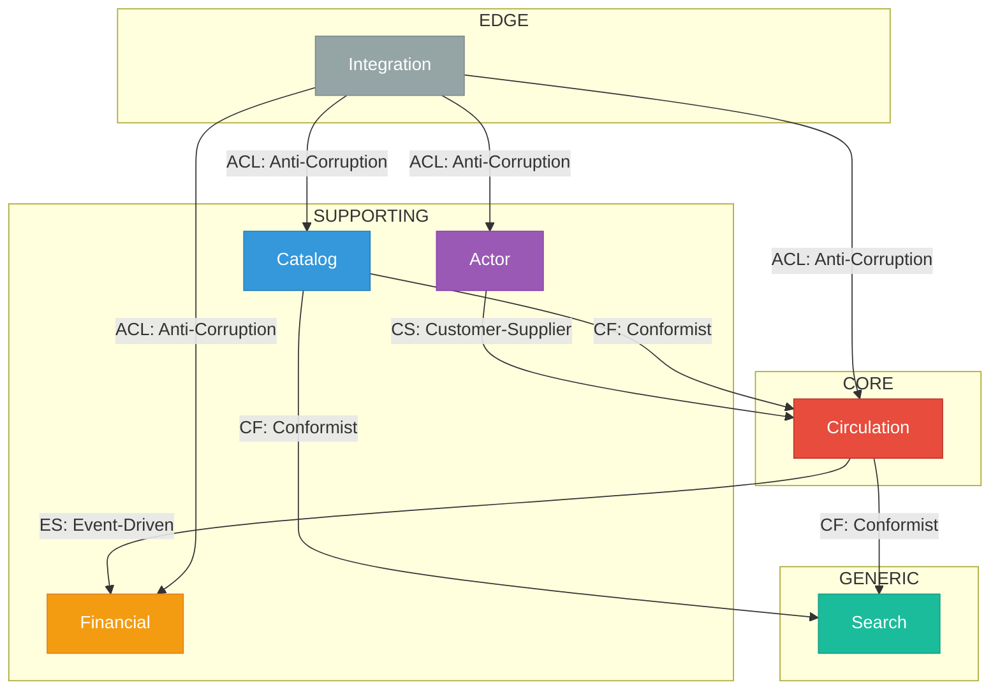

# Librery - Context Map (Mermaid)

---

## Quick Reference

| Context | Role | Tech |
|---------|------|------|
| Circulation | Core | Rust, Event Sourcing |
| Catalog | Supporting | Rust, Automerge |
| Actor | Supporting | Rust, Biscuit |
| Financial | Supporting | Rust, Events |
| Search | Generic | Rust, Tantivy |
| Integration | Edge | Rust, Extism |

---

*Generated: March 2026*